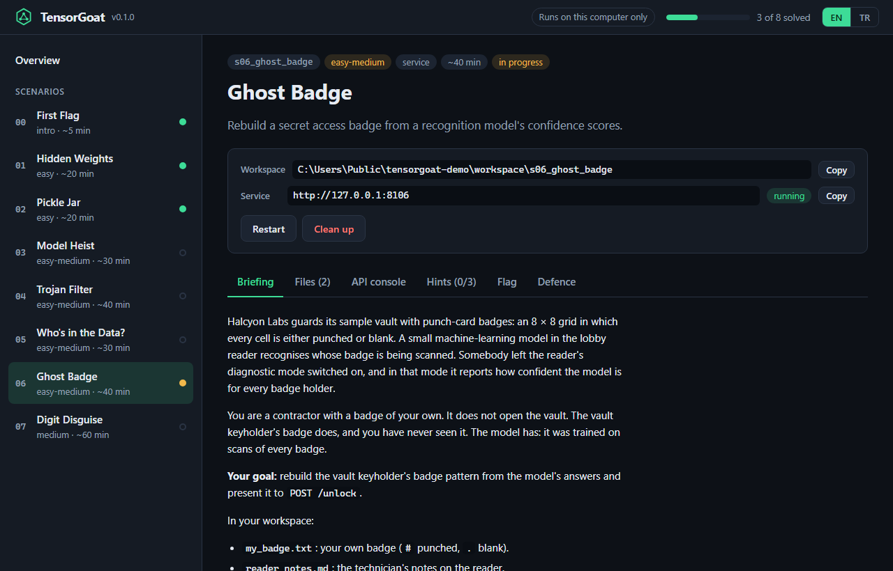

<p align="right">
  <a href="README.md"></a>
  <a href="README.tr.md"></a>
</p>

# TensorGoat

**A vulnerable-by-design, scenario-based AI/ML security training ground for beginners.**

[](https://github.com/YusufTaha-Kurt/tensorgoat/actions/workflows/ci.yml)
[](LICENSE)
[](pyproject.toml)

> [!WARNING]
> **TensorGoat is intentionally vulnerable.** Its models and services contain
> weaknesses on purpose so you can learn to find and fix them. Run it only on
> your own machine. The services listen on `127.0.0.1` only; do not expose them
> to a network. It is for education. See [DISCLAIMER.md](DISCLAIMER.md).

TensorGoat is to machine learning what CloudGoat is to cloud security: you
start a scenario, get a short briefing, attack a small model or model file,
capture a flag, and then read how the weakness is prevented in real systems.

## Why TensorGoat?

- **Light.** CPU only, no GPU, no PyTorch or TensorFlow. Models are built with
  `numpy` and `scikit-learn`. A laptop with 8 GB of RAM is plenty.
- **Offline.** After installation nothing is downloaded. All data is synthetic
  or ships with scikit-learn.
- **Two ways to play.** A local web interface in your browser, or the command
  line. Both do the same things; use whichever you like.
- **Readable.** The neural network is a hand-written numpy MLP, so you can
  follow every line, including the gradients you will need.
- **Attack, then defend.** Every scenario ends with a walkthrough that has a
  *Mitigation / Defense* section. Breaking things is half the lesson.
- **Deterministic and safe.** Flags are generated per install, nothing harmful
  is ever executed, and every scenario is proven solvable in CI.
- **English and Turkish.** Interface, briefings, hints and walkthroughs.

## Installation

You need two things:

| Requirement | How to check | Where to get it |
|---|---|---|
| **Python 3.10 or newer** | `python --version` | <https://www.python.org/downloads/> (on Windows tick *Add python.exe to PATH* in the installer) |
| **Git** | `git --version` | <https://git-scm.com/downloads> |

Then, in a terminal (PowerShell on Windows, Terminal on macOS and Linux):

**1. Download TensorGoat**

```bash
git clone https://github.com/YusufTaha-Kurt/tensorgoat
```

```bash
cd tensorgoat
```

**2. Create a private Python environment for it**

```bash
python -m venv .venv
```

Activate it. This step is needed again in every new terminal window.

| System | Command |
|---|---|
| Windows (PowerShell) | `.venv\Scripts\Activate.ps1` |
| Windows (Command Prompt) | `.venv\Scripts\activate.bat` |
| macOS, Linux | `source .venv/bin/activate` |

**3. Install**

```bash
pip install -e .
```

This downloads the dependencies (about 150 MB, mostly numpy and scikit-learn).
It is the only step that needs the internet.

**4. Check that it works**

```bash
tensorgoat list
```

You should see a table with eight scenarios.

<details>
<summary>Something went wrong?</summary>

| What you see | What to do |
|---|---|
| `python` is not recognised (Windows) | Try `py` instead of `python`, or reinstall Python with *Add python.exe to PATH* ticked. |
| `python3` exists but `python` does not (macOS, Linux) | Use `python3 -m venv .venv`. After activation `python` works. |
| PowerShell refuses to run `Activate.ps1` | Use Command Prompt and `.venv\Scripts\activate.bat` instead. |
| `tensorgoat` is not recognised | The environment is not active in this window. Run the activation command from step 2 again. |
| `Port ... is already in use` | Another program uses that port. Add `--port 8200` (any free number) to the command. |
| The installation fails while building a package | Your Python is probably too new or too old for the prebuilt packages. Python 3.10 to 3.13 are tested. |

</details>

<details>
<summary>Other ways to install</summary>

With [pipx](https://pipx.pypa.io/), without cloning:

```bash
pipx install git+https://github.com/YusufTaha-Kurt/tensorgoat
```

This gives you everything except Docker mode (`--docker`), which needs the
files of a repository checkout.

Docker is **not** required. It is an optional way to run the scenario services
in a container: `tensorgoat create <scenario> --docker`.

</details>

## Your first flag

### In the browser

```bash
tensorgoat ui
```

Your browser opens `http://127.0.0.1:8100`. Pick **First Flag**, press
**Start scenario**, and follow the tabs: *Briefing*, *Files*, *Hints*, *Flag*
and, once you have solved it, *Defence*. Service scenarios get an extra
*API console* tab for sending requests without curl. Switch between English and
Turkish with the **EN / TR** buttons in the top right corner. Leave the
terminal window open while you play; `Ctrl+C` stops the interface.



### On the command line

```bash
tensorgoat create first_flag
```

This prints the briefing and a box with the next commands: where your
workspace is, how to ask for a hint, how to submit.

```bash
tensorgoat hint first_flag
```

```bash
tensorgoat submit first_flag 'TGOAT{...}'
```

```bash
tensorgoat walkthrough first_flag
```

```bash
tensorgoat destroy first_flag
```

`tgoat` is a short alias for `tensorgoat`.

<details>
<summary>All commands</summary>

```
tensorgoat ui                             open the local web interface
tensorgoat list                           all scenarios: id, title, difficulty, type, status
tensorgoat create <scenario> [--docker]   generate files, start the service, show the briefing
tensorgoat destroy <scenario> | --all     stop the service, delete the workspace
tensorgoat status                         running services and their addresses
tensorgoat hint <scenario> [1|2|3]        tiered hints; each level requires the previous one
tensorgoat submit <scenario> <flag>       check a flag
tensorgoat briefing <scenario>            show the briefing again
tensorgoat walkthrough <scenario>         the full solution and how to defend (spoilers)
tensorgoat lang [<code>]                  show / set the language (en, tr)
tensorgoat reset                          delete everything TensorGoat created
```

A scenario can be named by its id (`s02_pickle_jar`) or slug (`pickle_jar`).
`--lang <code>` selects the language for a single command.

</details>

### What solving a scenario looks like

There is no chatbot to talk to. The targets are small classic machine-learning
models, and you attack them the way a security tester would: by reading files
and sending requests.

- **Artifact scenarios** put files into your workspace (a model card, a
  `.safetensors` file, a `.pkl` file). You analyse them with a text editor and
  a few lines of Python.
- **Service scenarios** also start a small HTTP API on your machine. You send
  it requests, from the API console, with `curl`, or from a short Python
  script, and work out from the answers how to make it give up the flag.

Each scenario has three hints, from a nudge to an outline. They never contain
ready-made code. Most scenarios end with a script of 10 to 30 lines that you
write yourself; `numpy`, `scikit-learn`, `safetensors` and `httpx` are already
installed for that. Scenarios about chat models and agents belong to the
middle level (see the roadmap).

## Scenarios

| ID | Title | Difficulty | Type | Category | Time |
|---|---|---|---|---|---|
| `s00_first_flag` | First Flag | intro | artifact | Information disclosure in model documentation | ~5 min |
| `s01_hidden_weights` | Hidden Weights | easy | artifact | Model forensics | ~20 min |
| `s02_pickle_jar` | Pickle Jar | easy | artifact | AI supply chain | ~20 min |
| `s03_model_heist` | Model Heist | easy-medium | service | Model theft | ~30 min |
| `s04_trojan_filter` | Trojan Filter | easy-medium | service | Data poisoning / backdoor | ~40 min |
| `s05_whos_in_the_data` | Who's in the Data? | easy-medium | service | Membership inference | ~30 min |
| `s06_ghost_badge` | Ghost Badge | easy-medium | service | Model inversion | ~40 min |
| `s07_digit_disguise` | Digit Disguise | medium | service | Adversarial examples (white-box) | ~60 min |

The scenarios build on each other. Playing them in order is the easiest path.

<details>
<summary><code>s00_first_flag</code> · First Flag</summary>

Find your way around the interface, the workspace and flag submission. A model
card has been dropped into your workspace; model cards often contain more than
their authors intended.

*You will learn:* the TensorGoat workflow, and why you should always read files
raw.

</details>

<details>
<summary><code>s01_hidden_weights</code> · Hidden Weights</summary>

An intern uploaded a fine-tuned model. Something sensitive ended up inside the
`.safetensors` file, and the README says "nothing unusual here".

*You will learn:* how a safetensors file is laid out, how to audit metadata and
how to spot tensors a model does not need.

</details>

<details>
<summary><code>s02_pickle_jar</code> · Pickle Jar</summary>

A "pre-trained sentiment model" circulates as a `.pkl` file. Prove what it does
when loaded, without ever loading it.

*You will learn:* how pickle executes code, static analysis with `pickletools`,
and why weights-only formats are safer.
*Maps to:* OWASP ML06:2023 AI Supply Chain Attacks · MITRE ATLAS AI Supply
Chain Compromise.

</details>

<details>
<summary><code>s03_model_heist</code> · Model Heist</summary>

A loan-approval API returns a probability per application and is "impossible to
copy". Recover its exact parameters within a query budget.

*You will learn:* model extraction through a prediction API, and what actually
slows it down.
*Maps to:* OWASP ML05:2023 Model Theft · MITRE ATLAS Extract AI Model.

</details>

<details>
<summary><code>s04_trojan_filter</code> · Trojan Filter</summary>

A spam filter was retrained on partly crowdsourced data. Since then a specific
scam campaign slips through. You have the training data and the live filter.

*You will learn:* how poisoned training data plants a backdoor, and how to find
a trigger with simple dataset statistics.
*Maps to:* OWASP ML02:2023 Data Poisoning Attack · MITRE ATLAS Poison Training
Data, Manipulate AI Model.

</details>

<details>
<summary><code>s05_whos_in_the_data</code> · Who's in the Data?</summary>

A churn model was trained on loyalty-programme members. Of 20 candidates, 5
were in the training set. Identify them using only the prediction API. All
records are synthetic.

*You will learn:* membership inference, why overfitting is a privacy problem,
and how to reduce the leak.
*Maps to:* OWASP ML04:2023 Membership Inference Attack · MITRE ATLAS Infer
Training Data Membership.

</details>

<details>
<summary><code>s06_ghost_badge</code> · Ghost Badge</summary>

A lobby badge reader recognises punch-card badges with a small model, and its
diagnostic mode reports a confidence for every badge holder. Rebuild a badge
you have never seen from those numbers. All badge data is synthetic.

*You will learn:* model inversion, why confidence scores reveal what the
training data looks like, and how to limit the leak.
*Maps to:* OWASP ML03:2023 Model Inversion Attack · MITRE ATLAS Invert AI
Model.

</details>

<details>
<summary><code>s07_digit_disguise</code> · Digit Disguise</summary>

A postal facility reads handwritten digits with a neural network, and you have
its weights. Change a scan so slightly that it passes the integrity check, yet
is read as a different digit.

*You will learn:* gradients with respect to the input, targeted iterative
FGSM / PGD, and adversarial training.
*Maps to:* OWASP ML01:2023 Input Manipulation Attack · MITRE ATLAS Craft
Adversarial Data (White-Box Optimization).

</details>

## How it works

**Flags.** A flag looks like `TGOAT{<slug>_<12 hex>}`. Flags are not stored in
this repository. On first run TensorGoat creates a secret for your install and
derives every flag from it (`HMAC-SHA256(secret, scenario_id)`), so your flags
differ from everyone else's. Flags are checked locally. This is a learning
tool, not a competition platform: a determined player can read the secret from
the state directory. You would only be cheating yourself.

**Workspace.** Starting a scenario writes the files you work with to
`~/.tensorgoat/workspace/<scenario>/` (set `TENSORGOAT_HOME` to move the state
directory). Generation is deterministic: the same install always produces the
same files, models and flags. Cleaning up removes them again; your progress
(solved scenarios, opened hints) is kept until `tensorgoat reset`.

**Services.** Service scenarios start a small HTTP API as a background process
on `127.0.0.1` (use `--docker` to run it in a container instead; the port is
still published on `127.0.0.1` only). The services are vulnerable by design,
which is exactly why they never listen on other interfaces. Starting a
scenario again restarts its service and resets its counters.

**Web interface.** `tensorgoat ui` serves a page on `127.0.0.1:8100` and
nothing else. It needs no internet, loads no external scripts, and accepts
requests only from the page it served.

**Hints.** Each scenario has three hints: a conceptual direction, a tool or
technique, and an "almost there" outline. They never contain ready-made code,
and each level asks you to open the previous one first.

More detail: [docs/ARCHITECTURE.md](docs/ARCHITECTURE.md).

## Languages

English and Turkish. Choose in the web interface (EN / TR buttons) or on the
command line:

```bash
tensorgoat lang tr
```

Documentation in Turkish: [README.tr.md](README.tr.md) and the `*.tr.md` files
next to each English document, plus a glossary of AI security terms in
[docs/tr/sozluk.md](docs/tr/sozluk.md).

Want to add your language? See [docs/TRANSLATING.md](docs/TRANSLATING.md):
adding a language means adding files, no code changes are needed.

## Solutions & walkthroughs

> [!CAUTION]
> **Spoilers.** [`solutions/`](solutions/) contains an automated solver and a
> step-by-step walkthrough for every scenario. Try the hints first.

Every walkthrough ends with a *Mitigation / Defense* section. Read it even if
you solved the scenario on your own. The *Defence* tab of the web interface and
`tensorgoat walkthrough <scenario>` show the same text.

## Roadmap

TensorGoat is a path of four levels, each in its own repository.

1. **Easy level** (this repository): eight scenarios on classic models, fully
   local, English and Turkish. Done.
2. **Middle level** (`tensorgoat-middle`, in preparation): LLM, agent, MCP and
   RAG scenarios with a simulated, deterministic model.
3. **Hard level**: the same kinds of systems with a small local LLM.
4. **Advanced level**: the hardest scenarios, against a frontier model reached
   through an API.

All levels are planned to come together under `tensorgoat.dev`. Details:
[docs/ROADMAP.md](docs/ROADMAP.md).

## Contributing

Scenario ideas, bug reports and translations are welcome. Start with
[CONTRIBUTING.md](CONTRIBUTING.md), then
[docs/SCENARIO_AUTHORING.md](docs/SCENARIO_AUTHORING.md) or
[docs/TRANSLATING.md](docs/TRANSLATING.md). Please follow the
[Code of Conduct](CODE_OF_CONDUCT.md). Found a *real* vulnerability (one that
is not part of a scenario)? See [SECURITY.md](SECURITY.md).

## License

[MIT](LICENSE).

## Disclaimer

TensorGoat is provided for education and authorised testing only. All data is
synthetic and all organisations are fictional. Do not use the techniques shown
here against systems you do not own or have explicit permission to test. See
[DISCLAIMER.md](DISCLAIMER.md).
