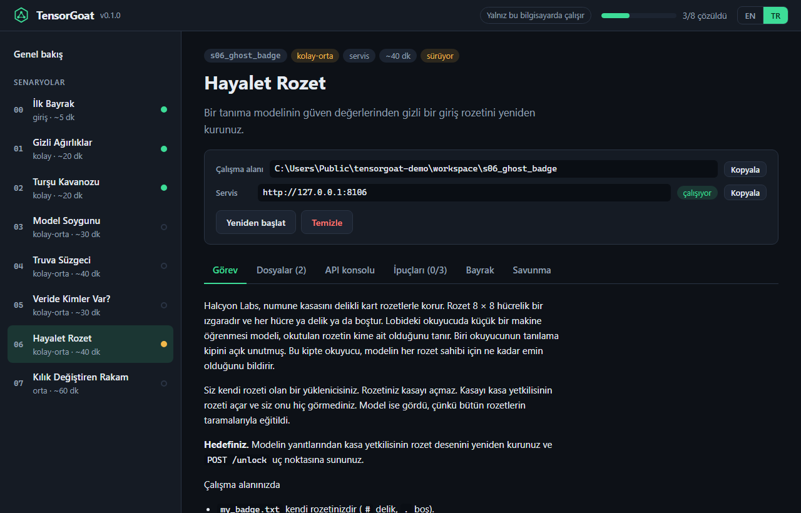

<p align="right">
  <a href="README.md"></a>
  <a href="README.tr.md"></a>
</p>

# TensorGoat

**Yeni başlayanlar için, bilerek zafiyetli bırakılmış, senaryo tabanlı bir yapay zekâ ve makine öğrenmesi güvenliği alıştırma ortamı.**

[](https://github.com/YusufTaha-Kurt/tensorgoat/actions/workflows/ci.yml)
[](LICENSE)
[](pyproject.toml)

> [!WARNING]
> **TensorGoat bilerek zafiyetlidir.** Modelleri ve servisleri, bulup gidermeyi
> öğrenmeniz için kasıtlı zafiyetler içerir. Yalnız kendi bilgisayarınızda
> çalıştırınız. Servisler yalnız `127.0.0.1` üzerinde dinler, onları ağa
> açmayınız. Eğitim amaçlıdır. Bakınız [DISCLAIMER.tr.md](DISCLAIMER.tr.md).

CloudGoat bulut güvenliği için neyse TensorGoat da makine öğrenmesi için odur.
Bir senaryo başlatılır, kısa bir görev tanımı okunur, küçük bir modele ya da
model dosyasına saldırılır, bayrak alınır ve sonunda bu zafiyetin gerçek
sistemlerde nasıl önlendiği okunur.

## Neden TensorGoat?

- **Hafif.** Yalnız işlemci kullanır. Ekran kartı, PyTorch ya da TensorFlow
  gerekmez. Modeller `numpy` ve `scikit-learn` ile kurulur. 8 GB bellekli bir
  dizüstü bilgisayar fazlasıyla yeter.
- **Çevrimdışı.** Kurulumdan sonra hiçbir şey indirilmez. Bütün veriler
  sentetiktir ya da scikit-learn ile birlikte gelir.
- **İki kullanım yolu.** Tarayıcıda açılan yerel bir web arayüzü ve komut
  satırı vardır. İkisi de aynı işi görür, hangisini isterseniz onu
  kullanabilirsiniz.
- **Okunabilir.** Sinir ağı elle yazılmış bir numpy MLP'dir. Gerek duyacağınız
  gradyanlar da içinde olmak üzere her satırı izleyebilirsiniz.
- **Önce saldırı, sonra savunma.** Her senaryo, *Önlem / Savunma* bölümü olan
  bir çözüm anlatımıyla biter. Kırmak dersin yarısıdır.
- **Belirlenimci ve güvenli.** Bayraklar kuruluma özel üretilir, zararlı hiçbir
  şey çalıştırılmaz ve her senaryonun çözülebildiği otomatik olarak kanıtlanır.
- **Türkçe ve İngilizce.** Arayüz, görev tanımları, ipuçları ve çözüm
  anlatımları iki dildedir.

## Kurulum

İki şey gereklidir.

| Gereksinim | Denetleme komutu | Nereden edinilir |
|---|---|---|
| **Python 3.10 ya da yenisi** | `python --version` | <https://www.python.org/downloads/> (Windows kurulumunda *Add python.exe to PATH* kutusunu işaretleyiniz) |
| **Git** | `git --version` | <https://git-scm.com/downloads> |

Ardından bir terminal açınız (Windows'ta PowerShell, macOS ve Linux'ta
Terminal) ve aşağıdaki adımları sırayla uygulayınız.

**1. TensorGoat'u indiriniz**

```bash
git clone https://github.com/YusufTaha-Kurt/tensorgoat
```

```bash
cd tensorgoat
```

**2. Ona özel bir Python ortamı oluşturunuz**

```bash
python -m venv .venv
```

Ortamı etkinleştiriniz. Bu adım her yeni terminal penceresinde yeniden
gereklidir.

| Sistem | Komut |
|---|---|
| Windows (PowerShell) | `.venv\Scripts\Activate.ps1` |
| Windows (Komut İstemi) | `.venv\Scripts\activate.bat` |
| macOS, Linux | `source .venv/bin/activate` |

**3. Kurunuz**

```bash
pip install -e .
```

Bu adımda bağımlılıklar indirilir (yaklaşık 150 MB, çoğu numpy ve
scikit-learn). İnternet gerektiren tek adım budur.

**4. Çalıştığını görünüz**

```bash
tensorgoat list
```

Sekiz senaryoluk bir tablo görünmelidir. Metinleri Türkçe görmek için dili bir
kez ayarlayınız.

```bash
tensorgoat lang tr
```

<details>
<summary>Sorun çıkarsa</summary>

| Görülen durum | Yapılacak iş |
|---|---|
| `python` tanınmıyor (Windows) | `python` yerine `py` yazınız ya da Python'u *Add python.exe to PATH* kutusu işaretli olarak yeniden kurunuz. |
| `python3` var ama `python` yok (macOS, Linux) | `python3 -m venv .venv` komutunu kullanınız. Etkinleştirmeden sonra `python` çalışır. |
| PowerShell `Activate.ps1` betiğini çalıştırmıyor | Komut İstemi'ni açıp `.venv\Scripts\activate.bat` komutunu kullanınız. |
| `tensorgoat` tanınmıyor | Ortam bu pencerede etkin değildir. İkinci adımdaki etkinleştirme komutunu yeniden çalıştırınız. |
| Port kullanılıyor iletisi | O portu başka bir program kullanıyor. Komuta `--port 8200` (boş herhangi bir sayı) ekleyiniz. |
| Kurulum bir paketi derlerken duruyor | Python sürümünüz hazır paketler için çok yeni ya da çok eski olabilir. Python 3.10 ile 3.13 arası sınanmıştır. |

</details>

<details>
<summary>Başka kurulum yolları</summary>

Depoyu indirmeden, [pipx](https://pipx.pypa.io/) ile kurabilirsiniz.

```bash
pipx install git+https://github.com/YusufTaha-Kurt/tensorgoat
```

Bu yolla Docker kipi (`--docker`) dışında her şey gelir. Docker kipi için
deponun dosyaları gereklidir.

Docker **zorunlu değildir**. Senaryo servislerini kapsayıcıda çalıştırmak için
isteğe bağlı bir yoldur.  `tensorgoat create <senaryo> --docker`

</details>

## İlk bayrağınız

### Tarayıcıda

```bash
tensorgoat ui
```

Tarayıcınızda `http://127.0.0.1:8100` açılır. **İlk Bayrak** senaryosunu
seçiniz, **Senaryoyu başlat** düğmesine basınız ve sekmeleri izleyiniz. Sekmeler
*Görev*, *Dosyalar*, *İpuçları*, *Bayrak* ve senaryo çözülünce açılan
*Savunma* sekmesidir. Servis senaryolarında, curl kullanmadan istek göndermek
için bir de *API konsolu* sekmesi vardır. Sağ üstteki **EN / TR** düğmeleriyle
dili değiştirebilirsiniz. Kullanırken terminal penceresini açık bırakınız,
arayüz `Ctrl+C` ile durur.



### Komut satırında

```bash
tensorgoat create first_flag
```

Bu komut görev tanımını ve kullanılacak komutların kutusunu yazdırır. Kutuda
çalışma alanınızın yeri, ipucu ve bayrak gönderme komutları vardır.

```bash
tensorgoat hint first_flag
```

```bash
tensorgoat submit first_flag 'TGOAT{...}'
```

```bash
tensorgoat walkthrough first_flag
```

```bash
tensorgoat destroy first_flag
```

`tgoat`, `tensorgoat` komutunun kısa adıdır.

<details>
<summary>Bütün komutlar</summary>

```
tensorgoat ui                             yerel web arayüzünü açar
tensorgoat list                           bütün senaryolar, kimlik, başlık, zorluk, tür, durum
tensorgoat create <senaryo> [--docker]    dosyaları üretir, servisi başlatır, görev tanımını gösterir
tensorgoat destroy <senaryo> | --all      servisi durdurur, çalışma alanını siler
tensorgoat status                         çalışan servisler ve adresleri
tensorgoat hint <senaryo> [1|2|3]         kademeli ipuçları, her düzey bir öncekini ister
tensorgoat submit <senaryo> <bayrak>      bayrağı denetler
tensorgoat briefing <senaryo>             görev tanımını yeniden gösterir
tensorgoat walkthrough <senaryo>          çözümün tamamı ve savunma (çözümü açık eder)
tensorgoat lang [<kod>]                   dili gösterir ya da ayarlar (en, tr)
tensorgoat reset                          TensorGoat'un oluşturduğu her şeyi siler
```

Senaryo, kimliğiyle (`s02_pickle_jar`) ya da kısa adıyla (`pickle_jar`)
yazılabilir. `--lang <kod>` dili tek komut için seçer.

</details>

### Bir senaryo nasıl çözülür

Konuşulacak bir sohbet robotu yoktur. Hedefler küçük, klasik makine öğrenmesi
modelleridir ve onlara bir güvenlik uzmanının yapacağı gibi, dosya okuyarak ve
istek göndererek saldırılır.

- **Dosya senaryoları** çalışma alanınıza dosyalar koyar (bir model kartı, bir
  `.safetensors` dosyası, bir `.pkl` dosyası). Bunları bir metin düzenleyici ve
  birkaç satır Python ile incelersiniz.
- **Servis senaryoları** ayrıca bilgisayarınızda küçük bir HTTP API başlatır.
  Ona API konsolundan, `curl` ile ya da kısa bir Python betiğiyle istek
  gönderir, yanıtlardan bayrağı nasıl vereceğini çıkarırsınız.

Her senaryoda, küçük bir yönlendirmeden yol taslağına uzanan üç ipucu vardır.
İpuçları hazır kod içermez. Çoğu senaryo, kendi yazdığınız 10 ile 30 satır
arası bir betikle biter. `numpy`, `scikit-learn`, `safetensors` ve `httpx`
bunun için kurulu gelir. Sohbet modelleri ve ajanlarla ilgili senaryolar orta
düzeyin konusudur (yol haritasına bakınız).

## Senaryolar

| Kimlik | Başlık | Zorluk | Tür | Kategori | Süre |
|---|---|---|---|---|---|
| `s00_first_flag` | İlk Bayrak | giriş | dosya | Model belgelerinde bilgi sızıntısı | ~5 dk |
| `s01_hidden_weights` | Gizli Ağırlıklar | kolay | dosya | Model dosyası incelemesi | ~20 dk |
| `s02_pickle_jar` | Turşu Kavanozu | kolay | dosya | Yapay zekâ tedarik zinciri | ~20 dk |
| `s03_model_heist` | Model Soygunu | kolay-orta | servis | Model hırsızlığı | ~30 dk |
| `s04_trojan_filter` | Truva Süzgeci | kolay-orta | servis | Veri zehirleme / arka kapı | ~40 dk |
| `s05_whos_in_the_data` | Veride Kimler Var? | kolay-orta | servis | Üyelik çıkarımı | ~30 dk |
| `s06_ghost_badge` | Hayalet Rozet | kolay-orta | servis | Model tersine çevirme | ~40 dk |
| `s07_digit_disguise` | Kılık Değiştiren Rakam | orta | servis | Çekişmeli örnekler (beyaz kutu) | ~60 dk |

Senaryolar birbirinin üzerine kuruludur. En kolay yol onları sırayla çözmektir.

<details>
<summary><code>s00_first_flag</code> · İlk Bayrak</summary>

Arayüzü, çalışma alanını ve bayrak göndermeyi tanırsınız. Çalışma alanınıza bir
model kartı konmuştur. Model kartları çoğu zaman yazarlarının niyet ettiğinden
fazlasını içerir.

*Öğrenecekleriniz.* TensorGoat iş akışı ve dosyaların neden her zaman ham
hâliyle okunması gerektiği.

</details>

<details>
<summary><code>s01_hidden_weights</code> · Gizli Ağırlıklar</summary>

Bir stajyer ince ayar yapılmış bir model yükledi. `.safetensors` dosyasının
içine hassas bir şey karıştı, README ise "olağandışı bir şey yok" diyor.

*Öğrenecekleriniz.* safetensors dosyasının düzeni, üstverinin denetlenmesi ve
modelin gerek duymadığı tensörlerin bulunması.

</details>

<details>
<summary><code>s02_pickle_jar</code> · Turşu Kavanozu</summary>

"Önceden eğitilmiş bir duygu analizi modeli" `.pkl` dosyası olarak dolaşıyor.
Yüklenince ne yaptığını, onu hiç yüklemeden kanıtlayınız.

*Öğrenecekleriniz.* pickle biçiminin nasıl kod çalıştırdığı, `pickletools` ile
statik analiz ve yalnız ağırlık taşıyan biçimlerin neden daha güvenli olduğu.
*Karşılığı.* OWASP ML06:2023 AI Supply Chain Attacks · MITRE ATLAS AI Supply
Chain Compromise.

</details>

<details>
<summary><code>s03_model_heist</code> · Model Soygunu</summary>

Bir kredi onay API'si her başvuru için bir olasılık döndürüyor ve
"kopyalanamaz" olduğu söyleniyor. Sorgu bütçesi içinde modelin parametrelerini
tam olarak çıkarınız.

*Öğrenecekleriniz.* Tahmin API'si üzerinden model çıkarma ve bunu gerçekten
neyin yavaşlattığı.
*Karşılığı.* OWASP ML05:2023 Model Theft · MITRE ATLAS Extract AI Model.

</details>

<details>
<summary><code>s04_trojan_filter</code> · Truva Süzgeci</summary>

Bir spam süzgeci, bir bölümü gönüllülerden toplanan veriyle yeniden eğitildi. O
günden beri belirli bir dolandırıcılık kampanyası süzgeçten geçiyor. Eğitim
verisi ve çalışan süzgeç sizdedir.

*Öğrenecekleriniz.* Zehirlenmiş eğitim verisinin nasıl arka kapı yerleştirdiği
ve tetikleyicinin basit veri kümesi istatistikleriyle nasıl bulunduğu.
*Karşılığı.* OWASP ML02:2023 Data Poisoning Attack · MITRE ATLAS Poison
Training Data, Manipulate AI Model.

</details>

<details>
<summary><code>s05_whos_in_the_data</code> · Veride Kimler Var?</summary>

Bir müşteri kaybı modeli sadakat programı üyeleriyle eğitildi. 20 adaydan 5'i
eğitim kümesindeydi. Onları yalnız tahmin API'sini kullanarak belirleyiniz.
Bütün kayıtlar sentetiktir.

*Öğrenecekleriniz.* Üyelik çıkarımı, aşırı öğrenmenin neden bir gizlilik sorunu
olduğu ve sızıntının nasıl azaltıldığı.
*Karşılığı.* OWASP ML04:2023 Membership Inference Attack · MITRE ATLAS Infer
Training Data Membership.

</details>

<details>
<summary><code>s06_ghost_badge</code> · Hayalet Rozet</summary>

Bir lobi okuyucusu delikli kart rozetleri küçük bir modelle tanıyor ve tanılama
kipi her rozet sahibi için bir güven değeri bildiriyor. Hiç görmediğiniz bir
rozeti bu sayılardan yeniden kurunuz. Bütün rozet verileri sentetiktir.

*Öğrenecekleriniz.* Model tersine çevirme, güven değerlerinin eğitim verisinin
neye benzediğini neden ele verdiği ve sızıntının nasıl sınırlandığı.
*Karşılığı.* OWASP ML03:2023 Model Inversion Attack · MITRE ATLAS Invert AI
Model.

</details>

<details>
<summary><code>s07_digit_disguise</code> · Kılık Değiştiren Rakam</summary>

Bir posta tesisi el yazısı rakamları sinir ağıyla okuyor ve ağırlıkları
sizdedir. Bir taramayı, bütünlük denetiminden geçecek kadar az ama başka bir
rakam olarak okunacak biçimde değiştiriniz.

*Öğrenecekleriniz.* Girdiye göre gradyan, hedefli yinelemeli FGSM / PGD ve
çekişmeli eğitim.
*Karşılığı.* OWASP ML01:2023 Input Manipulation Attack · MITRE ATLAS Craft
Adversarial Data (White-Box Optimization).

</details>

## Nasıl çalışır

**Bayraklar.** Bayrak `TGOAT{<kısa ad>_<12 onaltılık hane>}` biçimindedir.
Bayraklar bu depoda saklanmaz. TensorGoat ilk çalıştırmada kurulumunuza özel
bir anahtar üretir ve her bayrağı ondan türetir
(`HMAC-SHA256(anahtar, senaryo_kimliği)`). Bu yüzden bayraklarınız başka
herkesinkinden farklıdır. Bayraklar yerelde denetlenir. Bu bir öğrenme
aracıdır, yarışma ortamı değildir. Kararlı bir oyuncu anahtarı durum dizininden
okuyabilir, ama bununla yalnız kendini kandırmış olur.

**Çalışma alanı.** Bir senaryo başlatılınca üzerinde çalışacağınız dosyalar
`~/.tensorgoat/workspace/<senaryo>/` dizinine yazılır (durum dizinini taşımak
için `TENSORGOAT_HOME` ortam değişkenini ayarlayabilirsiniz). Üretim
belirlenimcidir. Aynı kurulum her zaman aynı dosyaları, modelleri ve bayrakları
üretir. Temizlik bu dosyaları siler. İlerlemeniz (çözülen senaryolar, açılan
ipuçları) `tensorgoat reset` komutuna kadar korunur.

**Servisler.** Servis senaryoları `127.0.0.1` üzerinde arka plan süreci olarak
küçük bir HTTP API başlatır (kapsayıcıda çalıştırmak için `--docker`
kullanılır, port yine yalnız `127.0.0.1` üzerinde yayımlanır). Servisler
tasarım gereği zafiyetlidir, başka ağ arayüzlerinde hiç dinlememelerinin nedeni
de budur. Bir senaryoyu yeniden başlatmak servisini yeniden başlatır ve
sayaçlarını sıfırlar.

**Web arayüzü.** `tensorgoat ui` yalnız `127.0.0.1:8100` üzerinde bir sayfa
sunar. İnternet gerektirmez, dışarıdan betik yüklemez ve yalnız kendi sunduğu
sayfadan gelen istekleri kabul eder.

**İpuçları.** Her senaryoda üç ipucu vardır. Bunlar kavramsal bir yön, bir araç
ya da teknik ve "neredeyse oldu" düzeyinde bir yol taslağıdır. Hazır kod
içermezler ve her düzey için bir önceki açılmış olmalıdır.

Ayrıntı için [docs/ARCHITECTURE.tr.md](docs/ARCHITECTURE.tr.md).

## Diller

Türkçe ve İngilizce. Dili web arayüzünden (EN / TR düğmeleri) ya da komut
satırından seçebilirsiniz.

```bash
tensorgoat lang tr
```

Her İngilizce belgenin yanında `*.tr.md` adlı Türkçe karşılığı vardır. Yapay
zekâ güvenliği terimlerinin sözlüğü [docs/tr/sozluk.md](docs/tr/sozluk.md)
dosyasındadır.

Başka bir dil eklemek için [docs/TRANSLATING.tr.md](docs/TRANSLATING.tr.md)
belgesine bakınız. Dil eklemek dosya eklemek demektir, kod değişikliği
gerekmez.

## Çözümler ve çözüm anlatımları

> [!CAUTION]
> **Çözümü açık eder.** [`solutions/`](solutions/) klasöründe her senaryo için
> otomatik bir çözücü ve adım adım bir çözüm anlatımı vardır. Önce ipuçlarını
> deneyiniz.

Her çözüm anlatımı *Önlem / Savunma* bölümüyle biter. Senaryoyu kendiniz
çözmüş olsanız da okuyunuz. Web arayüzünün *Savunma* sekmesi ve
`tensorgoat walkthrough <senaryo>` komutu aynı metni gösterir.

## Yol haritası

TensorGoat dört düzeyli bir yoldur ve her düzey ayrı bir depodadır.

1. **Kolay düzey** (bu depo). Klasik modeller üzerinde sekiz senaryo, tümüyle
   yerel, Türkçe ve İngilizce. Tamamlandı.
2. **Orta düzey** (`tensorgoat-middle`, hazırlanıyor). Simüle edilmiş,
   belirlenimci bir modelle LLM, ajan, MCP ve RAG senaryoları.
3. **Zor düzey.** Aynı tür sistemler, bu kez küçük bir yerel LLM ile.
4. **İleri düzey.** En zor senaryolar. Hedef, API üzerinden ulaşılan güncel
   bir büyük modeldir.

Bütün düzeylerin `tensorgoat.dev` altında toplanması planlanıyor. Ayrıntı için
[docs/ROADMAP.tr.md](docs/ROADMAP.tr.md).

## Katkı

Senaryo önerileri, hata bildirimleri ve çeviriler memnuniyetle karşılanır.
[CONTRIBUTING.tr.md](CONTRIBUTING.tr.md) ile başlayınız, ardından
[docs/SCENARIO_AUTHORING.tr.md](docs/SCENARIO_AUTHORING.tr.md) ya da
[docs/TRANSLATING.tr.md](docs/TRANSLATING.tr.md) belgesine geçiniz.
[Davranış Kuralları](CODE_OF_CONDUCT.tr.md) herkes için geçerlidir. *Gerçek* bir
güvenlik açığı (bir senaryonun parçası olmayan) bulduysanız
[SECURITY.tr.md](SECURITY.tr.md) belgesine bakınız.

## Lisans

[MIT](LICENSE).

## Sorumluluk reddi

TensorGoat yalnız eğitim ve yetkili güvenlik sınamaları için sunulur. Bütün
veriler sentetiktir ve bütün kuruluşlar kurgusaldır. Burada gösterilen
teknikleri sahibi olmadığınız ya da sınamak için açık izniniz bulunmayan
sistemlere karşı kullanmayınız. Bakınız [DISCLAIMER.tr.md](DISCLAIMER.tr.md).
